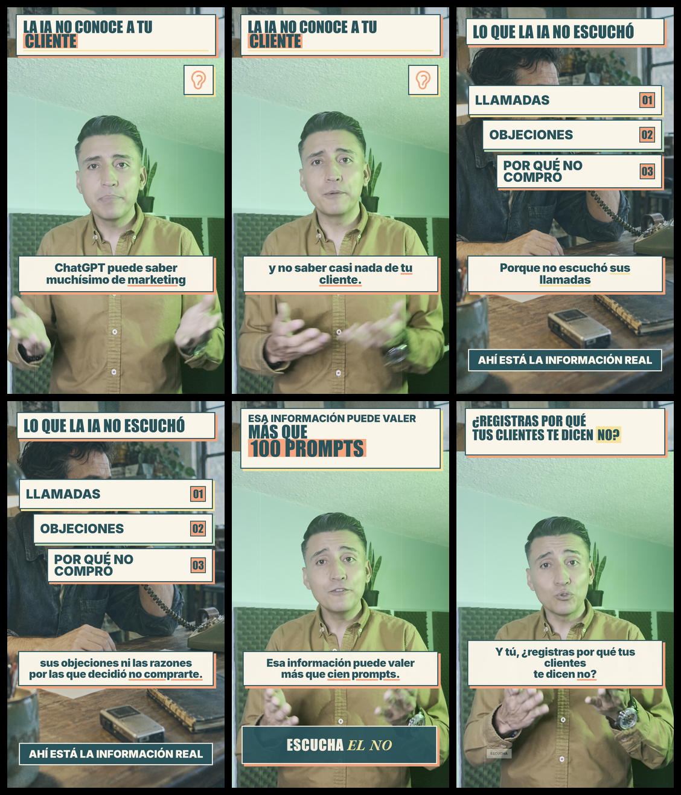

# Evidencia de QA post-render — VIDEO-13-FINAL.mp4

- **Estado técnico:** `PASS`
- **Aprobación editorial/visual:** `no evaluada`
- **Inicio UTC:** `2026-09-26T06:44:29.047Z`
- **Fin UTC:** `2026-09-26T06:44:36.547Z`
- **Tiempo total:** `7.499 s`
- **Entrada:** `/Users/iomijhondavid/Documents/Codex/Edicion de Videos/Serie-IA-Negocios-10-Videos/VIDEO-13/editable-hyperframes-video-13/renders/VIDEO-13-FINAL.mp4`
- **SHA-256:** `6ee143441088f43eb6aa0c318b6bf0505e9c8d8f91f7eaa893bda2f30491893e`
- **Entrada sin cambios:** `true`

> Un pase técnico confirma que las comprobaciones automatizadas terminaron. No equivale a aprobación humana ni a publicación.

## Metadatos principales

| Campo | Valor |
|---|---|
| Duración | 19.5 s |
| Contenedor | mov,mp4,m4a,3gp,3g2,mj2 |
| Video | hevc / Main 10 |
| Resolución | 1080×1920 |
| FPS | 30.0 |
| Pixel format | yuv420p10le |
| Color | bt2020 / arib-std-b67 / bt2020nc |
| Audio | aac / 48000 Hz / 2 canales |

## Pruebas automatizadas

| Prueba | Estado | Tiempo | Resultado |
|---|---:|---:|---|
| ffprobe | pass | 0.081 s | metadatos completos en `ffprobe.json` |
| Decodificación completa | pass | 2.16 s | exit 0 |
| EBU R128 | pass | 0.178 s | I -16.5 LUFS; LRA 3.8 LU; pico -1.6 dBFS |
| 6 fotogramas | pass | 4.506 s | 6 archivos |
| Hoja de contacto | pass | 0.547 s | `contact-sheet.png` |

## Fotogramas uniformes

- `frame-01.png` — `2.786 s` (0.142857 de la duración).
- `frame-02.png` — `5.571 s` (0.285714 de la duración).
- `frame-03.png` — `8.357 s` (0.428571 de la duración).
- `frame-04.png` — `11.143 s` (0.571429 de la duración).
- `frame-05.png` — `13.929 s` (0.714286 de la duración).
- `frame-06.png` — `16.714 s` (0.857143 de la duración).

La hoja conserva la señal decodificada y no aplica una conversión creativa de color. En material HLG/PQ debe interpretarse como evidencia de muestreo, no como simulación certificada de una pantalla HDR.

## Pendiente humano

Revisar reproducción completa, sincronía, color en una pantalla adecuada, encuadre, textos y contenido. Esta automatización no asigna el estado `aprobado`.
